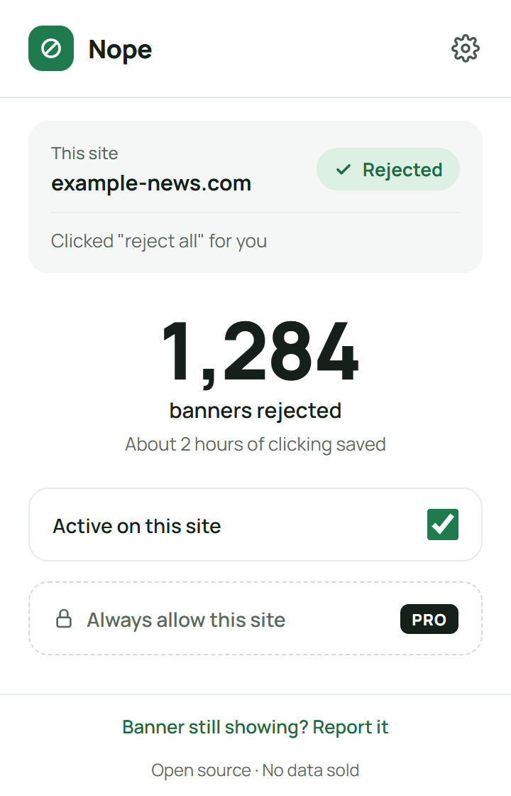
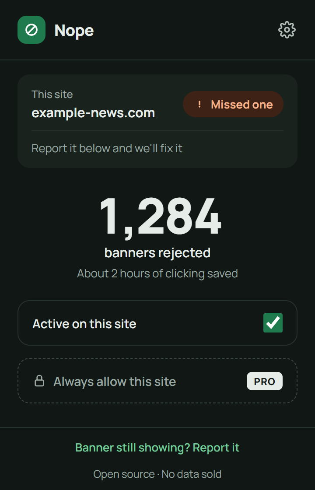
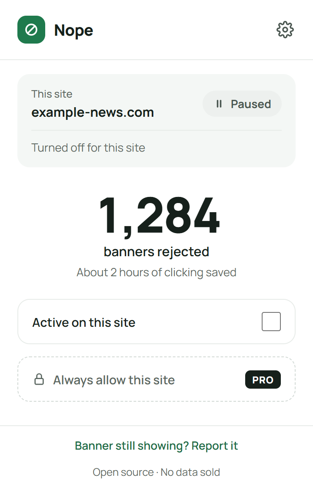

# Nope

A browser extension that clicks "reject all" on cookie banners for you, and hides the banner only when there is no way to reject. It never accepts cookies on your behalf.

- **Open source.** Every line of code is in this repository.
- **No data selling, ever.** Nothing you browse leaves your device. No analytics or telemetry.
- **Quick fixes.** Report a site that slips through, and the fix ships through a rules update.

<p>
  
  
  
</p>

More in [docs/screenshots](docs/screenshots): every popup state, the onboarding page and the settings page, in light and dark mode. Regenerate them with `npm run build && npm run screenshots`.

## Build

Requires Node.js 22 or later.

```sh
npm install
npm run build      # type-checks, then builds the extension into dist/
npm run watch      # rebuilds dist/ on every change
npm run icons      # redraws the PNG icons in icons/ (only needed after changing them)
npm test           # unit tests: the never-accept guard against every banner fixture
npm run check-sites -- https://www.onetrust.com/ https://www.spiegel.de/
                   # loads dist/ in Chromium, visits each site, prints the status reached
```

`check-sites` needs Playwright's Chromium once: `npx playwright install chromium`. Many sites only show a banner to visitors in Europe, so results depend on where you run it.

## How rejection works

Nope uses DuckDuckGo's [autoconsent](https://github.com/duckduckgo/autoconsent) as its engine and rule base: about 1,000 rules covering OneTrust, Cookiebot, Didomi, Quantcast, TrustArc, Sourcepoint, Usercentrics, Google and many single sites, plus a generic fallback that looks for a reject button. Nope configures it to only ever opt out, and to use the generic fallback in its "reject" mode only, never the modes that click "OK" or "Accept".

On top of that, every click goes through Nope's own guard ([src/content/safety.ts](src/content/safety.ts)). It refuses any button labelled to accept ("Accept all", "Allow all", "OK", "Stay opted in", and the same in German, French, Spanish, Italian and Dutch) and any link that would leave the page. If the guard blocks a click, the site is reported as "Missed one" so it can be fixed.

## Fixing a site without a store release

Nope's own rules live in [rules/rules.json](rules/rules.json). Once a day, the extension downloads that file from this repository's `main` branch: a plain request with no cookies, identifiers or query string. A downloaded file is used only if it passes a strict format check and has a higher `revision` than the copy the extension already has. Otherwise the extension keeps what it has.

To ship a fix:

1. Add a rule to `autoconsent`, in [autoconsent's rule format](https://github.com/duckduckgo/autoconsent/blob/main/docs/rule-syntax.md). To switch off an autoconsent rule that misbehaves, add its name to `disabledCmps`.
2. Increase `revision` by one.
3. Run `npm test`, which checks the file, then commit and push to `main`.

Users get the fix within a day. To test straight away, run `nopeDebug.refreshRules()` in the extension's service worker console. The settings page shows the rules revision in use and when it was last checked.

Rules are data only: they can name page elements to click or hide, and the names of snippets already bundled with the extension, but never code. Every click still goes through the never-accept guard.

## Load it in Chrome

1. Open `chrome://extensions` and turn on **Developer mode**.
2. Click **Load unpacked** and pick the `dist` folder.
3. After a rebuild, click the reload arrow on the extension's card.

To preview the toolbar icon states before the engine exists, open the service worker console from the extension card ("Inspect views: service worker") and run:

```js
nopeDebug.setStatus('rejected') // or 'hidden', 'none', 'missed', 'paused'
```

## Project layout

```
manifest.json            source manifest; name and version are filled in at build time
src/background.ts        per-tab status, toolbar icon, first-run onboarding
src/content/content.ts   runs on every page and frame, reports a status
src/content/engine.ts    runs autoconsent and turns its progress into a status
src/content/safety.ts    never-accept and never-navigate click guard
src/autoconsent-setup.ts autoconsent settings and per-frame rule selection
src/rules/               rules file format check and the daily refresh
tests/fixtures/          banner markup the guard is tested against
src/popup/ welcome/ options/
src/shared/brand.ts      product name, colors and URLs in one place
rules/rules.json         consent platform rules (data only, never code)
icons/                   generated toolbar icons
store/                   store listing text and images
PRIVACY.md               the privacy promise, linked from the extension and the store
```

## Releasing

1. Increase `version` in `package.json` (the manifest takes its version from there).
2. `npm run package` builds, tests and writes `release/nope-<version>.zip`.
3. Upload the zip in the Chrome Web Store and Edge Add-ons dashboards. Listing text, permission justifications and images are in [store/](store/LISTING.md).

To refresh the images after a design change: `npm run build && npm run screenshots && npm run store-images`.

## License

Nope's own code is MIT. The extension bundles [@duckduckgo/autoconsent](https://github.com/duckduckgo/autoconsent), which is licensed under the Mozilla Public License 2.0; its source is available at that link, unmodified.
